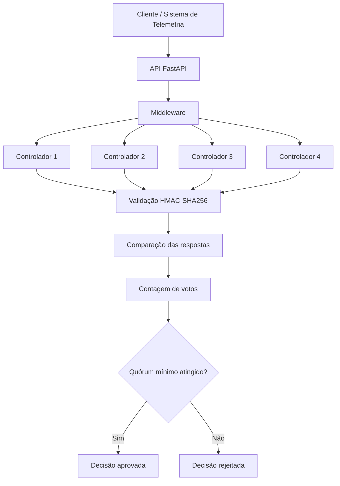

# MineFleet — Middleware Distribuído para Monitoramento e Controle de Frota de Mineração

## 1. Sobre o projeto

O **MineFleet** é um projeto acadêmico desenvolvido para a disciplina de **Sistemas Distribuídos**, do curso de Bacharelado em Sistemas de Informação do Instituto Federal de Minas Gerais (IFMG) – Campus Ouro Branco.

A proposta consiste no desenvolvimento de um middleware didático para monitoramento e controle de veículos utilizados em operações de mineração.

O sistema simula a comunicação entre sensores, controladores e um middleware responsável por receber dados de telemetria, verificar as respostas dos controladores e tomar decisões com base em um mecanismo de quórum.

Em um cenário de mineração, a disponibilidade e a confiabilidade das informações da frota são importantes para identificar condições operacionais que exigem atenção. Nesse contexto, o MineFleet utiliza conceitos de sistemas distribuídos para demonstrar como diferentes componentes podem colaborar na tomada de decisões.

## 2. Objetivos

O projeto tem como principais objetivos:

- Desenvolver uma API para recebimento e processamento de dados de telemetria.
- Simular múltiplos controladores responsáveis pelo processamento das informações.
- Implementar um mecanismo de quórum para validação das decisões.
- Utilizar assinaturas digitais HMAC-SHA256 para verificar a integridade e autenticidade das respostas.
- Simular falhas e divergências entre controladores.
- Demonstrar a comunicação assíncrona utilizando o protocolo MQTT.
- Utilizar bancos de dados SQLite para armazenar informações individualizadas dos controladores.

## 3. Tecnologias utilizadas

| Tecnologia | Aplicação |
|---|---|
| Python 3.13 | Linguagem de programação |
| FastAPI | Desenvolvimento da API REST |
| Uvicorn | Servidor ASGI |
| SQLite | Persistência de dados dos controladores |
| Paho-MQTT | Comunicação utilizando MQTT |
| Eclipse Mosquitto | Broker MQTT |
| HMAC-SHA256 | Verificação de integridade e autenticidade |
| Docker Compose | Inicialização do broker MQTT |
| Swagger / OpenAPI | Documentação e testes da API |
| Git e GitHub | Versionamento e hospedagem do projeto |

## 4. Arquitetura do sistema

O MineFleet foi organizado em componentes com responsabilidades distintas.

### 4.1. Fluxo de processamento da telemetria

O fluxo principal acontece da seguinte maneira:

1. Um cliente envia os dados de telemetria para a API.
2. O middleware recebe a requisição HTTP.
3. Os quatro controladores processam os dados recebidos.
4. Cada controlador registra suas informações em seu próprio banco SQLite.
5. As respostas são assinadas utilizando HMAC-SHA256.
6. O middleware verifica as assinaturas e compara os resultados.
7. O sistema contabiliza os votos válidos.
8. Caso o número de respostas concordantes alcance o quórum mínimo, a decisão é aprovada.



### 4.2. Controladores independentes

O projeto utiliza quatro controladores lógicos:

- `controlador-1`
- `controlador-2`
- `controlador-3`
- `controlador-4`

Cada controlador possui seu próprio arquivo de banco de dados SQLite, permitindo separar os registros de cada componente.

O quórum mínimo configurado é de **3 respostas concordantes entre os 4 controladores**.

**Observação:** nesta implementação acadêmica, os controladores são componentes lógicos executados dentro do mesmo processo da aplicação FastAPI. Eles possuem persistência separada, mas não representam quatro servidores físicos ou processos distribuídos independentes.

## 5. Mecanismo de quórum e segurança

O mecanismo de quórum permite que o middleware compare as respostas recebidas dos controladores antes de aprovar uma decisão.

O sistema considera:

- Controladores disponíveis.
- Controladores indisponíveis.
- Respostas divergentes.
- Assinaturas inválidas.
- Quantidade de votos concordantes.
- Atendimento ou não ao quórum mínimo.

### 5.1. HMAC-SHA256

O projeto utiliza HMAC-SHA256 para gerar e verificar assinaturas das respostas dos controladores.

Essa técnica permite verificar se uma mensagem foi produzida por alguém que conhece a chave secreta compartilhada e se seu conteúdo permaneceu íntegro.

O middleware valida as assinaturas antes de considerar as respostas no processo de votação.

### 5.2. Regra de telemetria

Para demonstrar o funcionamento do sistema, foi implementada uma regra simples de temperatura:

| Temperatura | Resultado |
|---|---|
| Menor que 80 °C | NORMAL |
| Maior ou igual a 80 °C | ALERTA |

Quando a temperatura atinge ou ultrapassa 80 °C, o sistema classifica a condição como `ALERTA`.

### 5.3. Simulação de falhas

A aplicação permite simular situações de falha e divergência nos controladores.

Entre os cenários possíveis estão:

- Controlador disponível e respondendo normalmente.
- Controlador indisponível.
- Controlador disponível, mas apresentando resposta divergente.

Essas situações permitem observar como o middleware se comporta diante de respostas inconsistentes e indisponibilidade de componentes.

## 6. Comunicação MQTT

Além da API REST, o projeto apresenta uma demonstração de comunicação assíncrona utilizando MQTT.

O broker utilizado é o Eclipse Mosquitto, executado por meio do Docker Compose.

O projeto possui dois componentes:

**Sensor (`sensor.py`)**

Responsável por publicar mensagens de telemetria no tópico:

```text
minefleet/caminhoes/telemetria
```

**Atuador (`atuador.py`)**

Responsável por se inscrever no tópico:

```text
minefleet/caminhoes/alertas
```

O componente permanece aguardando mensagens de alerta publicadas nesse tópico.

**Importante:** a demonstração MQTT é executada separadamente do fluxo principal da API REST. O sensor MQTT não encaminha automaticamente os dados para o endpoint `/telemetry`, e a resposta de atuação da API é simulada. Portanto, não há integração automática entre o processamento HTTP e a publicação MQTT nesta versão.

## 7. Estrutura do projeto

```text
MineFleet-Middleware-Distribuido/
│
├── app/
│   ├── __init__.py
│   ├── config.py
│   ├── controller.py
│   ├── main.py
│   ├── middleware.py
│   └── security.py
│
├── data/
│   ├── controlador-1.db
│   ├── controlador-2.db
│   ├── controlador-3.db
│   └── controlador-4.db
│
├── docs/
│   └── RELATORIO_BASE.md
│
├── mosquitto/
│   └── mosquitto.conf
│
├── atuador.py
├── sensor.py
├── docker-compose.yml
├── requirements.txt
├── .gitignore
└── README.md
```

**Descrição dos principais arquivos:**

| Arquivo | Responsabilidade |
|---|---|
| `app/main.py` | Inicialização da API e definição dos endpoints |
| `app/config.py` | Configurações gerais do sistema |
| `app/controller.py` | Implementação dos controladores e processamento da telemetria |
| `app/middleware.py` | Coordenação dos controladores e validação do quórum |
| `app/security.py` | Geração e verificação das assinaturas HMAC-SHA256 |
| `sensor.py` | Simulação de publicação de telemetria via MQTT |
| `atuador.py` | Simulação de recebimento de alertas via MQTT |
| `docker-compose.yml` | Configuração do ambiente Docker |
| `mosquitto/mosquitto.conf` | Configuração do broker MQTT |
| `requirements.txt` | Dependências Python |
| `docs/RELATORIO_BASE.md` | Documento de apoio ao relatório do projeto |

Os arquivos de banco de dados são gerados localmente durante a execução e não precisam ser enviados ao GitHub.

## 8. Como executar o projeto

### 8.1. Pré-requisitos

Antes de iniciar, é necessário possuir:

- Python 3.13 ou superior.
- Git.
- Docker Desktop com Docker Compose.
- Visual Studio Code (opcional, mas recomendado).

### 8.2. Clonar o repositório

Abra o terminal e execute:

```powershell
git clone https://github.com/FelipeAlexandre777/MineFleet-Middleware-Distribuido.git
```

Entre na pasta:

```powershell
cd MineFleet-Middleware-Distribuido
```

### 8.3. Criar o ambiente virtual

```powershell
python -m venv .venv
```

Caso o PowerShell bloqueie a ativação do ambiente virtual, execute:

```powershell
Set-ExecutionPolicy -Scope Process -ExecutionPolicy RemoteSigned
```

Em seguida, ative o ambiente:

```powershell
.\.venv\Scripts\Activate.ps1
```

### 8.4. Instalar as dependências

Com o ambiente virtual ativado:

```powershell
pip install -r requirements.txt
```

### 8.5. Inicializar o broker MQTT

Com o Docker Desktop em execução, execute:

```powershell
docker compose up -d
```

Para verificar os containers:

```powershell
docker compose ps
```

O broker Mosquitto utiliza a porta `1883`.

### 8.6. Iniciar a API

Na raiz do projeto, execute:

```powershell
python -m uvicorn app.main:app --reload
```

Após a inicialização, a API estará disponível em:

```text
http://127.0.0.1:8000
```

## 9. Documentação e testes da API

O FastAPI disponibiliza uma interface interativa baseada no Swagger.

Acesse:

**Swagger UI:**

http://127.0.0.1:8000/docs

**OpenAPI:**

http://127.0.0.1:8000/openapi.json

**Página inicial:**

http://127.0.0.1:8000/

### 9.1. Endpoints disponíveis

| Método | Endpoint | Descrição |
|---|---|---|
| GET | `/` | Página inicial e informações da aplicação |
| GET | `/controllers` | Consulta o estado dos controladores |
| POST | `/telemetry` | Envia dados de telemetria para processamento |
| POST | `/controllers/{controller_id}/simulate` | Simula alterações no estado de um controlador |
| POST | `/controllers/restore` | Restaura os controladores |

### 9.2. Enviando dados de telemetria

No Swagger, localize o endpoint:

```http
POST /telemetry
```

Utilize o seguinte exemplo de requisição:

```json
{
  "vehicle_id": "CAM-042",
  "sequence": 1,
  "temperature": 85
}
```

Nesse exemplo:

- `vehicle_id`: identificador do veículo.
- `sequence`: número sequencial da mensagem.
- `temperature`: temperatura recebida do veículo.

Como a temperatura informada é de 85 °C, o resultado esperado é `ALERTA`.

## 10. Cenários de testes realizados

Foram executados testes práticos para verificar o comportamento do middleware diante de diferentes condições.

### Teste 1 — Funcionamento normal

**Objetivo:** verificar o processamento da telemetria com os quatro controladores disponíveis e concordantes.

Requisição:

```json
{
  "vehicle_id": "CAM-042",
  "sequence": 1,
  "temperature": 85
}
```

Resultado observado:

```text
Quórum aprovado: 4/4
```

Os quatro controladores responderam com a mesma decisão, permitindo a aprovação do processamento.

### Teste 2 — Resposta divergente

**Objetivo:** verificar se o middleware identifica divergências entre os controladores e mantém a decisão quando o quórum é alcançado.

Primeiro, foi realizada a simulação de divergência no controlador 4:

```http
POST /controllers/controlador-4/simulate
```

Corpo da requisição:

```json
{
  "online": true,
  "divergent": true
}
```

Em seguida, foi enviada uma nova telemetria:

```json
{
  "vehicle_id": "CAM-042",
  "sequence": 2,
  "temperature": 85
}
```

Resultado observado:

```text
Quórum aprovado: 3/4
```

Três controladores apresentaram respostas concordantes, enquanto o quarto apresentou uma decisão divergente.

Mesmo com a divergência, o middleware conseguiu atingir o quórum mínimo de três votos.

### Teste 3 — Controlador indisponível

**Objetivo:** verificar o comportamento do sistema quando um dos controladores deixa de responder.

Foi realizada a simulação de indisponibilidade do controlador 4:

```http
POST /controllers/controlador-4/simulate
```

Corpo da requisição:

```json
{
  "online": false,
  "divergent": false
}
```

O sistema passou a identificar o controlador como indisponível.

A telemetria foi enviada novamente para verificar o processamento com os controladores restantes.

O cenário permitiu verificar a continuidade do processamento mesmo com a indisponibilidade de um dos quatro controladores.

### Teste 4 — Comunicação MQTT

**Objetivo:** verificar a conexão do atuador com o broker Mosquitto.

Com o broker em execução, foi iniciado o atuador:

```powershell
python atuador.py
```

Saída observada:

```text
Aguardando alertas. Ctrl+C para parar.
Atuador conectado: Success
```

A mensagem confirma que o componente conseguiu estabelecer conexão com o broker MQTT.

## 11. Encerrando a aplicação

Para interromper a API, utilize:

```text
CTRL + C
```

Para interromper o broker MQTT:

```powershell
docker compose down
```

Para remover também os volumes associados ao Compose, quando aplicável:

```powershell
docker compose down -v
```

## 12. Limitações e considerações

O MineFleet foi desenvolvido com finalidade acadêmica e didática. Portanto, algumas características precisam ser consideradas:

- Os quatro controladores são componentes lógicos executados no mesmo processo da aplicação, e não servidores independentes.
- O mecanismo de quórum demonstra votação por maioria, mas não constitui uma implementação formal de tolerância a falhas bizantinas (BFT).
- A chave HMAC utilizada é uma configuração didática local e não representa uma gestão segura de chaves para produção.
- A comunicação MQTT está demonstrada em um fluxo separado da API REST.
- A resposta de atuação apresentada pela API é simulada.
- O sistema não deve ser utilizado para controlar veículos ou equipamentos reais sem desenvolvimento, integração, validação e testes adicionais.

Essas limitações não comprometem o objetivo didático do projeto, que é demonstrar conceitos fundamentais de middleware, comunicação, persistência, verificação de integridade, disponibilidade e consenso por quórum.

## 13. Conclusão

O desenvolvimento do MineFleet permitiu aplicar conceitos de Sistemas Distribuídos em um cenário inspirado nas operações de mineração.

A implementação demonstrou o recebimento e processamento de dados de telemetria, a utilização de múltiplos controladores lógicos, a persistência individualizada, a verificação de assinaturas HMAC-SHA256 e a tomada de decisão baseada em quórum.

Os testes realizados demonstraram o funcionamento do mecanismo de votação em condições normais, diante de respostas divergentes e com a indisponibilidade de um controlador.

Também foi desenvolvida uma demonstração de comunicação assíncrona utilizando MQTT e o broker Eclipse Mosquitto.

Dessa forma, o projeto apresenta uma aplicação prática de conceitos estudados na disciplina, permitindo compreender como diferentes componentes podem colaborar para processar informações e tomar decisões em um ambiente distribuído simulado.

---

## 14. Informações acadêmicas

**Projeto:** MineFleet — Middleware Distribuído para Monitoramento e Controle de Frota de Mineração

**Instituição:** Instituto Federal de Educação, Ciência e Tecnologia de Minas Gerais (IFMG)

**Campus:** Ouro Branco

**Curso:** Bacharelado em Sistemas de Informação

**Disciplina:** Sistemas Distribuídos

**Repositório:** [GitHub — MineFleet Middleware Distribuído](https://github.com/FelipeAlexandre777/MineFleet-Middleware-Distribuido)

---

*Projeto acadêmico desenvolvido para fins de estudo e demonstração prática de conceitos de Sistemas Distribuídos.*
